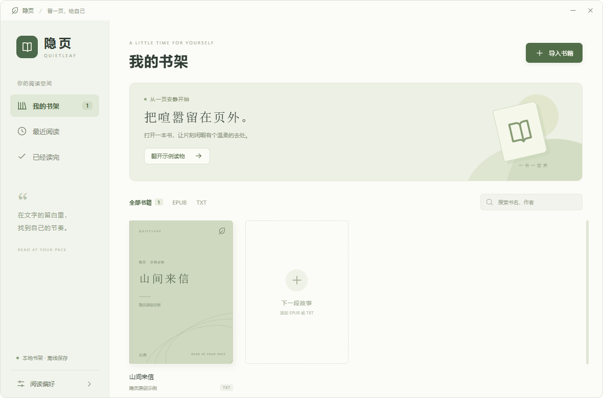
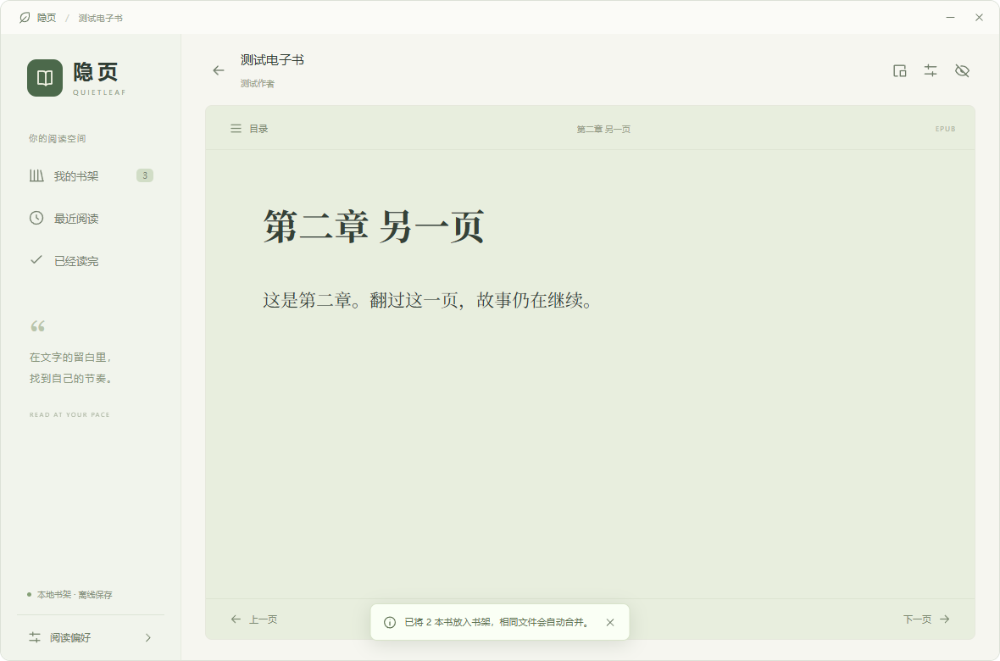

# 隐页第一版验证记录

记录覆盖 2026 年 10 月 19 日至 20 日，使用 Windows x64 和 Ubuntu 22.04 WSL，Electron 44.9.0。当前交付版本为 0.1.4。

## 0.1.2 已完成的检查

| 检查                            | 结果             | 范围                                                                                                                                      |
| ------------------------------- | ---------------- | ----------------------------------------------------------------------------------------------------------------------------------------- |
| npm test                        | 18 项通过        | TXT 编码与字节索引、长段落及 emoji、设置边界、移出透明与移入恢复、自动隐藏开关和老板键状态隔离、书架去重和持久化、异常 EPUB、索引备份恢复 |
| npm run build                   | 通过             | Vue 和 TypeScript 类型检查、前端构建、主进程及预加载和 TXT 工作线程构建                                                                   |
| npx playwright test             | 3 项桌面流程通过 | TXT/EPUB 阅读、透明度、悬浮开关位置、移出全透明、原区域恢复、交互锁、老板键、重启位置、读完分类及移除                                     |
| EPUB 隔离检查                   | 通过             | 测试 EPUB 中的脚本未逃逸到主页面；书籍框架没有桌面接口；主页面未暴露 require                                                              |
| npm run pack:win                | 通过             | 使用已下载的 Electron 运行时生成 Windows x64 ZIP，避免重复下载导致的网络中断                                                              |
| node scripts/smoke-packaged.mjs | 通过             | 启动打包后的 quietleaf.exe，检查本地协议资源、TXT 工作线程导入和章节阅读                                                                  |
| npm audit --omit=dev            | 0 项已知漏洞     | 已固定 EPUB 依赖的 XML 解析器到 0.8.15，构建使用 esbuild 0.28.2                                                                           |

Windows 包位于 `release/0.1.2/quietleaf-0.1.2-win-x64.zip`，文件大小为 161,208,832 字节。这是解压运行包，不需要在使用机器上安装 Node.js；测试直接运行了同次打包产生的 `release/0.1.2/win-unpacked/quietleaf.exe`，其中悬浮开关、移出全透明和移入恢复均已通过成品检查。运行新版前，需从旧版托盘菜单退出应用，避免单实例机制唤回旧窗口。

0.1.1 将原来的背景与文字透明度改为整窗统一透明度，并新增工具栏滑块、Ctrl+Alt+0 和托盘恢复入口。16 项单元测试与 2 项桌面流程测试通过；透明度流程检查了实际截图 alpha：24% 时最大值为 61/255，1% 时约为 3/255，恢复后为 255/255，确认没有不透明的标题栏或工具区域。TXT 与 EPUB 均覆盖，重启后设置保留，旧背景透明度可迁移。

0.1.2 将自动隐藏开关移到悬浮阅读右上角、整窗透明度左侧，使用鼠标图标和选中状态表示开关。移出后根层不透明度临时为 0，不改写用户的透明度偏好，不再创建独立唤醒窗口。自动流程确认隐藏截图所有像素 alpha 为 0，主窗口仍在原位置且没有额外窗口；移回后从 0 恢复为此前的 24%，TXT 与 EPUB 都能恢复。关闭开关或打开透明度弹层时，移出保持可见。

为了兼容全透明像素无法接收鼠标事件的情况，仅在移出隐藏期间每 100 毫秒读取系统光标位置，进入原窗口区域后恢复。桌面测试分别覆盖页面鼠标事件和注入系统坐标的区域检测；物理鼠标、多屏及 UOS 合成器仍需实机验证。老板键仍真正隐藏窗口，鼠标移入不会恢复老板键隐藏。

首次桌面测试发现离线资源过滤误拦了应用自身的本地界面文件，导致 ERR_UNEXPECTED。现已限定放行应用资源目录，后续完整流程与打包启动检查均已通过。

## 2026 年 10 月 20 日 ARM64 打包检查

使用 Windows x64 下载并整理 Electron ARM64 运行时，通过现有 Ubuntu 22.04 WSL 的 `dpkg-deb` 生成安装包，不在 x86 环境启动 ARM64 程序。

- `npm run pack:linux:arm64` 完整通过，类型检查和构建通过，`npm run format:check` 通过。
- DEB：`release/0.1.2/quietleaf-0.1.2-linux-arm64.deb`，132,327,402 字节。
- tar.gz：`release/0.1.2/quietleaf-0.1.2-linux-arm64.tar.gz`，132,353,085 字节。
- 包内 6 个 ELF 均为 64 位小端 AArch64（机器类型 183），DEB 架构字段为 `arm64`。
- 随包 ELF 引用的最高 glibc 版本符号为 2.25，已写入 DEB 的 libc6 最低依赖；这只反映这些二进制声明的符号要求，不代表目标系统完整运行环境已验收。
- DEB 使用 gzip 压缩，包含桌面入口、图标和命令入口；沙箱辅助程序以 root 所有权和 4755 权限安装，未禁用 Chromium 沙箱。
- tar.gz 中主程序和辅助程序的执行权限为 755，数据文件为 644；已检查归档目录与应用资源。
- 同目录提供 `.sha256` 和 `-build.json`，记录校验和、ELF 列表、依赖与 `nativeLaunchTested: false`。

本次将 Linux 封装改为系统标准 `dpkg-deb`，避免原 FPM 流程对项目主页的必填要求；项目尚无主页地址，没有添加虚构网址。Linux x64 复用该封装流程，但本次没有生成 x64 Linux 产物。

## 0.1.3：UOS X11 外框透明适配

用户已在 UOS 安装并运行 0.1.2，反馈页面透明和移出隐藏时仍保留圆角外框、阴影，并确认桌面会话为 X11。仅在页面根层设置 alpha 无法控制窗口管理器额外绘制的装饰，Electron 的 `setOpacity` 在 Linux 上也不生效。

本版对当前阅读器窗口设置 EWMH `_NET_WM_WINDOW_OPACITY`，使内容和系统外框统一合成；支持时页面 alpha 为 1，避免 24% 再次相乘变成 5.76%。快速拖动请求按 50 毫秒合并并串行执行。缺少工具或窗口管理器不声明支持时保留页面透明方式并写日志。DEB 增加 `x11-utils` 依赖，不修改桌面的全局合成配置。

X11 自动隐藏改为 `BrowserWindow.hide()`，保存隐藏前的屏幕区域，每 100 毫秒检测光标返回后使用 `showInactive()` 恢复。没有提示条，用户设定的透明度、书籍和进度保存路径保持不变。

- 22 项单元测试通过，包括真实 XID 格式、1%/24%/100% 透明值、缺少支持时回退、请求顺序和退出取消。
- Windows 的 3 项真实 Electron 桌面回归全部通过。
- Ubuntu 22.04 WSL 中使用独立 Xvfb、Openbox 和 xcompmgr，实际运行 Linux x64 阅读器，通过 `xprop` 读回 1%/24%/100% 的原生属性值，确认页面 alpha 不重复降低。
- Linux X11 流程确认原生窗口移出后 `isVisible()` 为 false，系统光标进入原区域后恢复，窗口边界及 24% 设置保留，Ctrl+Alt+0 恢复 100%。
- 本次 Linux X11 流程始终保持 Chromium 沙箱开启。测试使用注入的系统光标坐标；UOS DDE 自身装饰效果、多屏和物理鼠标仍需目标机复测。
- 0.1.3 的 ARM64 产物位于 `release/0.1.3/`，包内架构和权限检查沿用上面的封装流程。

## 0.1.4：背景透明与正文清晰度分别控制

悬浮阅读默认使用独立背景模式，只在根层绘制一层 RGBA 背景，内部阅读容器和 EPUB 文档背景透明，正文独立合成。背景默认 12%、可设为 0%；正文默认 100%、可调至 20%。提供“背景全透明，文字清晰”预设，并保留原来的整窗透明模式。

背景模式中，X11 原生整窗透明度固定为 100%，不把背景数值传给系统整窗属性，也不对页面根层再次降低 opacity。Windows 和 X11 在背景模式中使用窗口几何区域判断鼠标出入，避免透明像素不接收鼠标事件时发生隐藏与恢复闪烁。

- 24 项单元测试通过，新增旧版透明度迁移、参数独立性及旧资料升级后书籍和进度保留。
- 4 项 Windows Electron 桌面流程通过，新增 TXT、EPUB 的真实透明 PNG 像素检查：背景 0%/文字 100% 时，空白 alpha 为 0、文字最大 alpha 为 255；背景 25% 时空白 alpha 为 64、文字仍为 255；背景 0%/文字 50% 时正文最大 alpha 为 128。
- 验证从背景模式切换到整窗 24%，再切回背景模式，正文恢复清晰，旧的整窗数值不再叠加。
- Linux X11 流程通过，实际读回背景模式原生 opacity 为 4294967295（100%），页面背景 RGBA 为 0，正文 opacity 为 1，两种模式的原生隐藏与原区域恢复均通过。
- Windows 0.1.4 ZIP 成品检查通过：导入、章节、整窗透明、背景全透明且正文清晰。
- 旧版只有整窗数值的设置自动迁移到独立背景模式，原数值作为背景透明度，正文恢复为 100%；资料版本仍为 1，不改书籍和进度格式。

UOS DDE 的实际装饰、字体与底层 Word 叠加效果仍需用户在目标机复测。

## 仍需验证的内容

- 已生成 ARM64 DEB 和 tar.gz，开发机没有 UOS/飞腾实机环境；0.1.4 在目标设备上的独立背景、外框、隐藏及恢复效果仍待用户复测。
- GitHub Actions 配置已提供，但没有上传仓库或触发远端 CI；系统运行库兼容和实际启动仍待验证。
- 桌面自动流程验证了隐藏入口、原窗口区域恢复和状态切换；物理全局组合键、系统托盘鼠标操作、多屏和长时间挂机仍需手工验收。
- Windows 透明截图与 Linux X11 属性、隐藏检查不能替代 UOS DDE 合成器及飞腾显卡的表现。
- EPUB 测试使用生成的双章节样本；还需用用户实际阅读的图文书、字体和排版样本建立兼容集合。

完整依赖审计还报告 8 项中危构建工具链提示，来源于 electron-builder 的间接依赖链；运行依赖审计为 0。尚未强制降级打包器或覆盖其跨主版本依赖，以免引入未经验证的构建变化。

## 截图

书架与阅读截图来自实际 Electron 窗口：

## 参考资料

- [Electron 上下文隔离](https://www.electronjs.org/docs/latest/tutorial/context-isolation)
- [Electron 安全建议](https://www.electronjs.org/docs/latest/tutorial/security/)
- [epub.js 项目](https://github.com/futurepress/epub.js)
- [electron-builder 跨平台构建](https://www.electron.build/docs/features/multi-platform-build/)
- [EWMH 整窗透明度规范](https://specifications.freedesktop.org/wm/latest/ar01s05.html)
- [Electron BaseWindow：Linux 透明度限制](https://www.electronjs.org/docs/latest/api/base-window#winsetopacityopacity-windows-macos)
